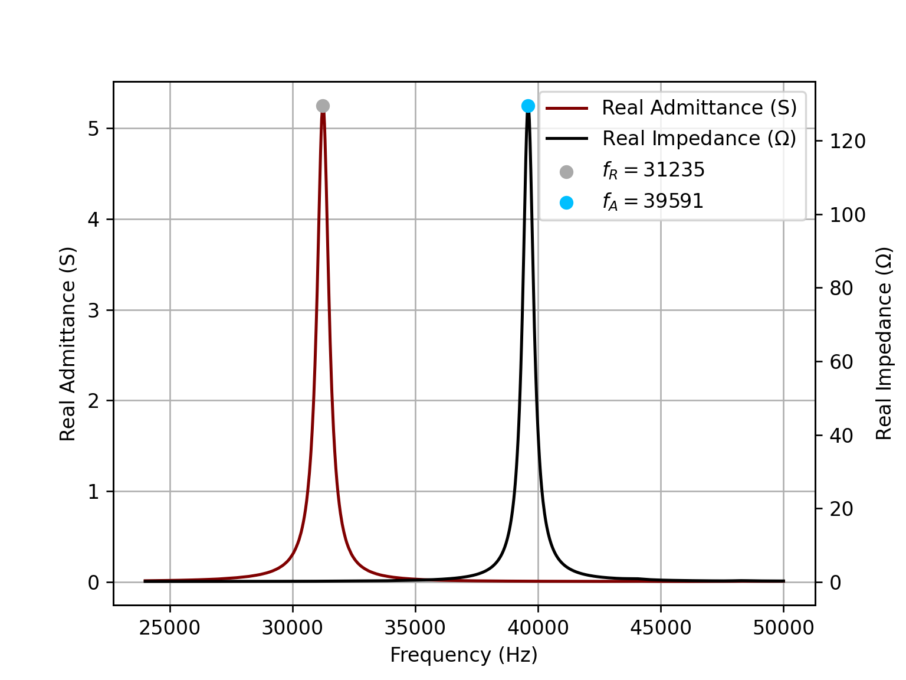
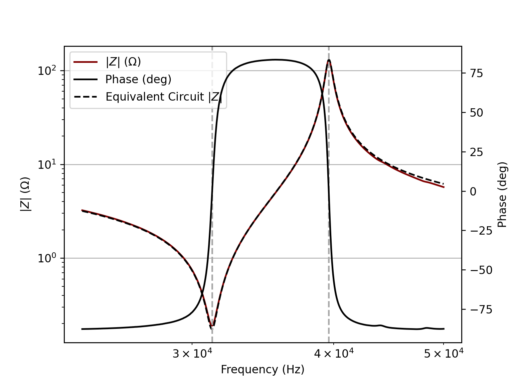

# PiezoLab

PiezoLab is a Python package for working with piezoelectric impedance data and extracting Butterworth-Van Dyke (BVD) 
equivalent circuit parameters from frequency sweeps.

It provides:

- An `Impedance` class for turning magnitude/phase data into complex impedance and admittance
- Automatic estimation of resonant and anti-resonant frequencies
- Initial BVD parameter extraction for `R1`, `C0`, `Qm`, `C1`, and `L1`
- Optional nonlinear fitting with `scipy.optimize.curve_fit`
- A weighted least-squares fit for noisy or resonance-sensitive datasets
- Bundled sample datasets for quick testing and examples

## Installation

PiezoLab can be installed with pip

```bash
pip install piezolab
```

For editable development installs, clone the repository and run:

```bash
pip install -e .
```

## Quick Start

```python
import matplotlib.pyplot as plt

from piezolab import Impedance, get_data

frequency, magnitude, phase_deg = get_data("clean_resonant_data")

impedance = Impedance(frequency, magnitude, phase_deg)
impedance.least_squares_fit(resonance_weight=100)

impedance.plot_real()
impedance.plot_impedance()
impedance.summarize()

plt.show()
```

This will show the real admittance and impedance plots as well as the fitted impedance magnitude and phase as shown
below.





## Data Model

Create an `Impedance` object from three NumPy arrays:

- `frequency`: frequency in Hz
- `impedance_magnitude`: impedance magnitude in ohms
- `impedance_phase_deg`: impedance phase in degrees

```python
from piezolab import Impedance

imp = Impedance(frequency, impedance_magnitude, impedance_phase_deg)
```

During initialization, the class computes:

- `impedance_complex`
- `angular_frequency`
- `admittance_complex`
- `real_impedance`
- `real_admittance`
- `admittance_phase_deg`

It also calls `resolve_resonance()` automatically to estimate the main BVD parameters.

## Resolved Parameters

After initialization, these attributes are available:

- `resonant_frequency` (`fR`)
- `anti_resonant_frequency` (`fA`)
- `motional_resistance` (`R1`)
- `static_capacitance` (`C0`)
- `resonant_quality_factor` (`Qm`)
- `motional_capacitance` (`C1`)
- `motional_inductance` (`L1`)

These values are first estimated directly from the measured impedance/admittance response, then can be refined with
fitting.

## Fitting Methods

### `curve_fit()`

Uses `scipy.optimize.curve_fit` to fit the BVD model to the real and imaginary parts of the impedance.

```python
imp.curve_fit()
```

Optional off-resonance capacitance constraint:

```python
imp.curve_fit(off_res_cap=True)
imp.curve_fit(off_res_cap=120e-9)
```

Behavior:

- `off_res_cap=None` or `False`: fit `C0`, `C1`, `R1`, and `L1`
- `off_res_cap=True`: estimate off-resonance capacitance from early low-frequency points and constrain the fit
- `off_res_cap=<float>`: use a manually supplied off-resonance capacitance value

If your dataset does not provide enough off-resonance points with `off_res_cap=True`, then a warning will be issued as 
the estimate may be inaccurate. In that case, consider manually providing the float value.

### `least_squares_fit()`

Uses `scipy.optimize.least_squares` with nonnegative parameter bounds and optional weighting near resonance.

```python
result = imp.least_squares_fit(
    resonance_weight=5.0,
    resonance_width=None,
    frequency_weights=None,
    off_res_cap=None,
)
```

Key options:

- `resonance_weight`: increases the importance of points near `fR`
- `resonance_width`: width of the resonance weighting window in rad/s
- `frequency_weights`: custom weight array matching the frequency array shape
- `off_res_cap`: same constrained-fit options as `curve_fit()`

This method is the better starting point when:

- the resonance region matters more than off-resonance behavior
- you want direct control over weighting

## Plotting

### `plot_real()`

Plots:

- real admittance vs frequency
- real impedance vs frequency
- markers for `fR` and `fA`

```python
fig, ax_admittance, ax_impedance = imp.plot_real()
```

### `plot_impedance()`

Plots:

- measured impedance magnitude
- measured phase
- BVD equivalent circuit magnitude overlay

```python
fig, ax_mag, ax_phase = imp.plot_impedance()
```

`plot_impedance()` overlays the model response generated from the current fitted or estimated parameters, so it is most
useful after `curve_fit()` or `least_squares_fit()`.

## Summary Output

`summarize()` prints the extracted BVD model parameters and an ASCII representation of the equivalent circuit:

```python
imp.summarize()
```

The documented circuit is:

```text
            |------|| C0 ------|
            |                  |
---o--------|                  |--------o---
            |                  |
            |---R1---L1---C1---|
```

## Equivalent Circuit Evaluation

If you need the modeled impedance directly, use:

```python
z_model = imp.equivalent_impedance(1j*imp.angular_frequency)
```

The argument is the complex frequency `s`, typically `jω`.

## Bundled Sample Data

The package includes four sample datasets accessible through `get_data()`:

- `clean_resonant_data`
- `clean_sweep_data`
- `messy_sweep_data`
- `messy_resonant_data`

Example:

```python
from piezolab import get_data

frequency, magnitude, phase_deg = get_data("messy_sweep_data")
```

`get_data()` returns:

- frequency array
- impedance magnitude array
- impedance phase array in degrees

## Example Scripts

The `examples/` folder shows a few typical workflows:

- `examples/clean_data.py`: clean resonant data with weighted least-squares fitting
- `examples/messy_data.py`: messy sweep data with automatically estimated off-resonance capacitance
- `examples/messy_resonant_data.py`: messy resonant data with manually constrained off-resonance capacitance

## Notes and Assumptions

- Input data should represent a single dominant resonance suitable for a BVD approximation.
- The automatic off-resonance capacitance estimate assumes the first low-frequency points are sufficiently far from
  resonance.
- If your low-frequency region is not truly off resonance, pass `off_res_cap` manually instead of relying on automatic
  estimation.
- `least_squares_fit()` validates custom `frequency_weights` shape and rejects invalid resonance weighting parameters.
- Resonance detection is based on maxima in real admittance (`fR`) and real impedance (`fA`).

## Minimal Workflow

```python
from piezolab import Impedance

imp = Impedance(frequency, magnitude, phase_deg)
imp.resolve_resonance()
imp.curve_fit()
imp.summarize()
```

## Dependencies

PiezoLab depends on:

- `numpy`
- `matplotlib`
- `scipy`

## License

PiezoLab is licensed under the MIT License. See the [LICENSE](LICENSE) file for the full text.
